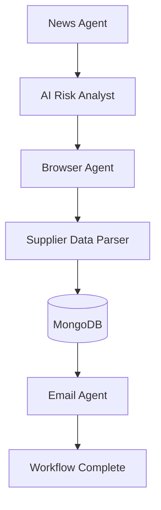
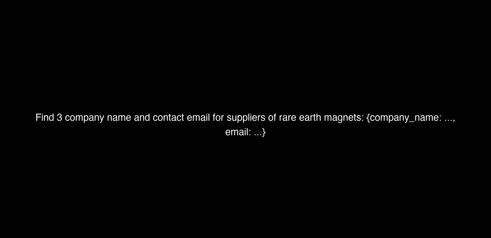

# Agentic AI for Supply Chain Risk Management

A multi-agent AI prototype developed during an internship at Ford Otosan to identify supply chain risks, discover alternative suppliers, and automate initial supplier outreach.

The project combines LLM-based risk analysis, web research, structured data extraction, database persistence, and email automation in a single LangGraph workflow.

## Features

- News collection and identification of potential supply chain disruptions.
- AI-powered prioritization of the most critical risk and generation of supplier search queries.
- Browser-based research for alternative suppliers and their contact information.
- Extraction of company names, email addresses, and relevant products or services into structured records.
- Email format validation and supplier record persistence in MongoDB.
- Automated initial supplier outreach through an email agent.
- Streamlit dashboard for launching the workflow and inspecting execution logs.

## Architecture



LangGraph coordinates the six sequential stages. The risk analyst generates a targeted supplier search prompt from the collected news. The browser agent researches alternatives, and the parser converts its output into structured supplier records. Valid records are stored with a pending status before the email agent is invoked.

## Technology Stack

| Technology | Purpose |
| --- | --- |
| Python | Application and agent development |
| LangGraph | Stateful workflow orchestration |
| LangChain | LLM integration |
| Google Gemini | Risk analysis and information extraction |
| MongoDB / PyMongo | Supplier data persistence |
| Gmail API / Google OAuth | Email integration |
| Streamlit | Web dashboard |
| python-dotenv | Environment configuration |

## Project Structure

```text
supply_chain_ford_internship/
├── browser_agent/             # Browser research components
├── gmail_agent/               # Email agent components
├── newsagent/                 # News collection components
├── tools/                     # Agent integration modules
├── main_orchestrator.py       # LangGraph workflow
├── supply_chain_frontend.py   # Streamlit interface
├── agent_history.gif          # Agent execution visualization
├── requirements.txt           # Listed Python dependencies
└── test.py                    # Test script
```

## Getting Started

### 1. Clone the repository

```bash
git clone https://github.com/saltindag22/supply_chain_ford_internship.git
cd supply_chain_ford_internship
```

### 2. Create a virtual environment

```bash
python3 -m venv .venv
source .venv/bin/activate
```

On Windows, use `.venv\Scripts\activate` instead.

### 3. Install dependencies

```bash
python -m pip install -r requirements.txt
python -m pip install langgraph langchain-google-genai streamlit
```

The existing requirements file does not list all packages imported by the application. Additional browser or news agent dependencies may be required; inspect the corresponding modules before running the project.

### 4. Configure environment variables

Create a local `.env` file in the repository root:

```dotenv
GOOGLE_API_KEY=your_google_api_key
MONGO_URI=your_mongodb_connection_uri
DB_NAME=ai_agent_db
```

Configure Gmail API access and OAuth credentials according to the email agent's implementation. Additional configuration may be required by the individual agents. Never commit real API keys, database credentials, OAuth files, or access tokens.

The source references legacy Gemini 1.5 model identifiers. If these are no longer available, update the model identifiers in `main_orchestrator.py` to supported models and use compatible package versions.

### 5. Run the application

**Important:** The workflow can write to MongoDB and send real emails. Before running it, use a test database and test recipients, or disable the email stage while evaluating the system.

Launch the Streamlit dashboard from the repository root:

```bash
streamlit run supply_chain_frontend.py
```

Alternatively, execute the workflow directly:

```bash
python main_orchestrator.py
```

## Supplier Data

The workflow extracts supplier records and stores them in the MongoDB `mailing_list` collection. An illustrative record is shown below:

```json
{
  "company_name": "Example Supplier",
  "email": "contact@example.com",
  "product_name": "Industrial components",
  "status": "pending"
}
```

Email validation checks the address format; it does not establish deliverability or verify supplier authenticity.

## Demo



## Future Improvements

- Human approval before external supplier outreach.
- Supplier deduplication and independent contact verification.
- Risk scoring and prioritization across multiple disruptions.
- More robust workflow retries, structured logging, and error handling.
- Automated integration tests and reproducible dependency versions.

## Project Status

This repository contains an internship prototype, not a production-ready procurement platform. AI-generated risk assessments and supplier information should be independently verified before business decisions are made. Use only authorized data, accounts, and credentials when running the application.
